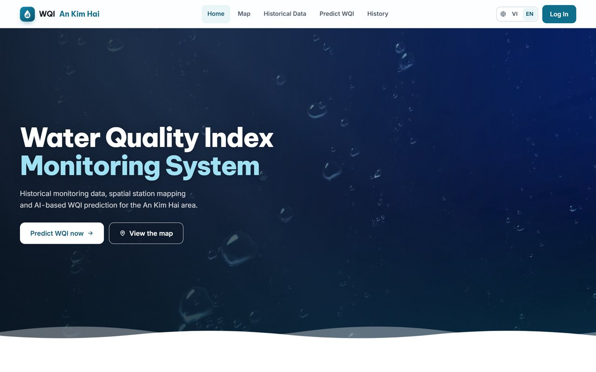
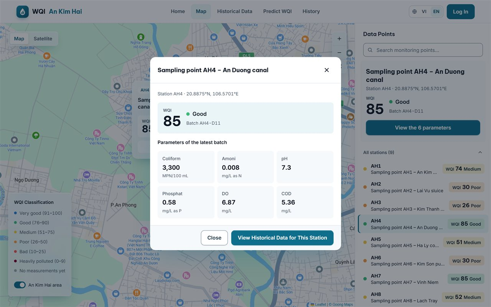
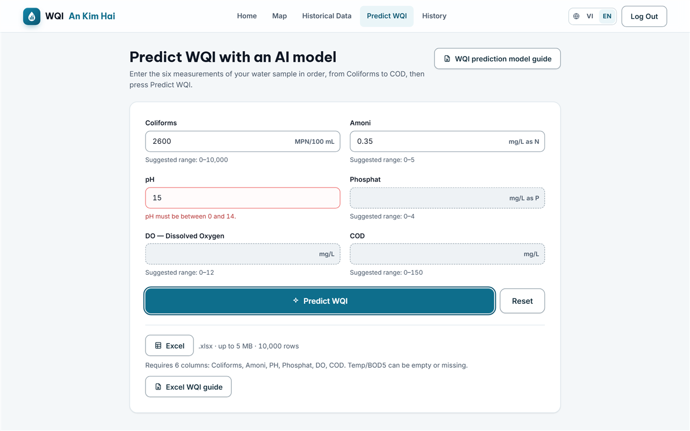
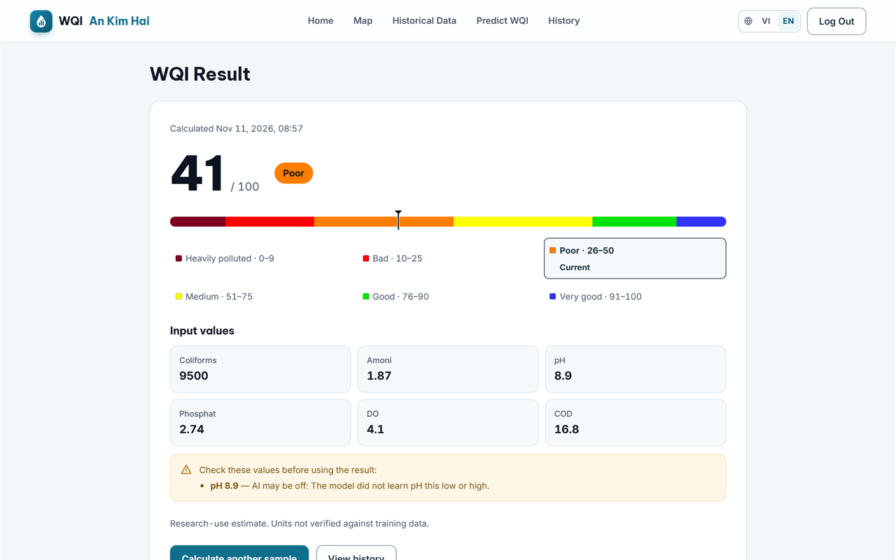
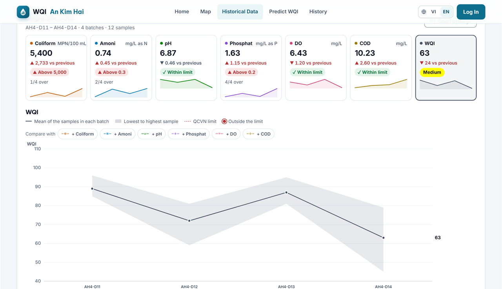
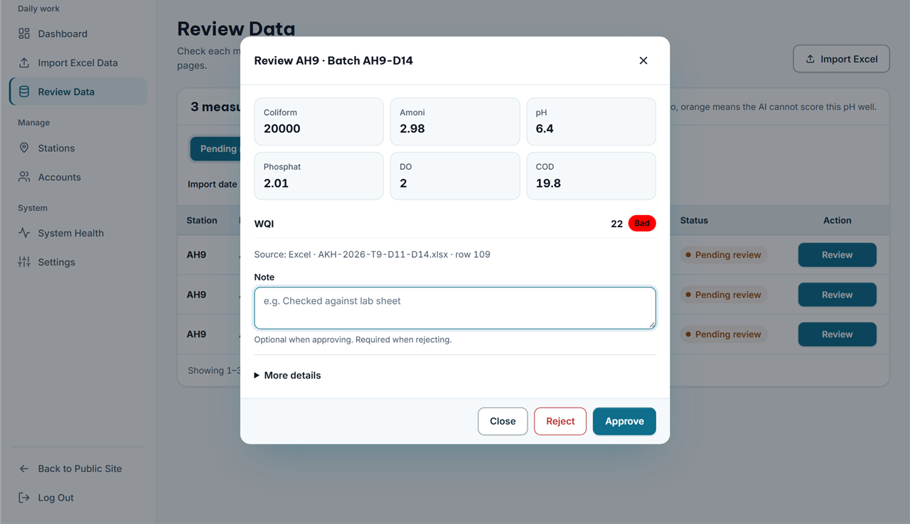
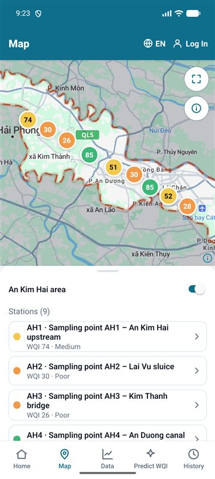

<div align="center">


# Hệ thống WQI An Kim Hải

[](https://nodejs.org/)
[](https://react.dev/)
[](https://expressjs.com/)
[](https://www.mongodb.com/)
[](https://fastapi.tiangolo.com/)
[](https://expo.dev/)
[](https://github.com/TuAnh6point9/WDP301_Project/actions/workflows/ci.yml)

**[Mở bản chạy thật](https://wqi-project.vercel.app)** · [Cài đặt nhanh](#cài-đặt-nhanh) · [Tài liệu](#tài-liệu)

</div>

**WQI An Kim Hải** là hệ thống theo dõi chất lượng nước khu vực An Kim Hải (Hải Phòng). Người dùng xem trạm quan trắc trên bản đồ, tra cứu số đo theo từng đợt lấy mẫu và dự đoán chỉ số WQI bằng AI từ 6 chỉ số Coliforms, Amoni, PH, Phosphat, DO, COD. Hệ thống gồm web, app Android, API Express/MongoDB và dịch vụ AI chạy model CatBoost.

<p align="center">
  
  
</p>

<p align="center">
  
  
</p>

<p align="center">
  
  
</p>

## Tính năng

**Khách (không cần đăng nhập)**

- Xem trạm trên bản đồ và đợt đo đã duyệt mới nhất của từng trạm.
- Tra cứu dữ liệu quan trắc, xem biểu đồ WQI theo mã đợt, tải CSV.
- Dự đoán WQI từ 6 chỉ số (xem kết quả, không lưu).

**Người dùng đăng nhập**

- Lưu kết quả dự đoán, xem lịch sử, in báo cáo, xuất Excel.
- Tính WQI hàng loạt từ file Excel (chạy nền; bị gián đoạn thì bấm **Tiếp tục**).

**Admin**

- Nhập dữ liệu Excel theo mã đợt, duyệt, từ chối hoặc khoá bản ghi đo.
- Quản lý trạm quan trắc và tài khoản người dùng.
- Xem tình trạng hệ thống, chọn cột QCVN làm đường giới hạn trên biểu đồ.

Giao diện có hai ngôn ngữ Việt–Anh và hướng dẫn từng bước. App Android có các chức năng của khách và người dùng.

## Công nghệ

| Phần | Công nghệ | Thư mục |
|---|---|---|
| Web | React 19, Vite, Leaflet + Goong | `client/` |
| API | Express 5, MongoDB (Mongoose) | `server/` |
| Kiểu dùng chung | TypeScript, Zod | `packages/contracts/` |
| AI | Python 3.12, FastAPI, CatBoost | `ai/` |
| App Android | Expo SDK 58, React Native | `mobile/` |
| Kiểm thử | Vitest, Playwright, pytest | `e2e/`, `server/tests/`, `ai/tests/` |

Một lần dự đoán WQI diễn ra như sau:

1. Người dùng nhập 6 chỉ số trên web hoặc app.
2. API kiểm tra dữ liệu rồi gửi sang dịch vụ AI.
3. AI chạy model CatBoost (callisto 2.0), trả điểm WQI từ 0 đến 100 và mức chất lượng.
4. API kiểm tra kết quả và lưu lại nếu người dùng đã đăng nhập.

## Cài đặt nhanh

Cần có: [Git](https://git-scm.com/downloads/win), [Node.js 22](https://nodejs.org/en/download) (kèm npm 10+), [uv](https://docs.astral.sh/uv/getting-started/installation/) để chạy AI, và [MongoDB](https://www.mongodb.com/try/download/community) chạy trên máy (hoặc MongoDB Atlas).

Chạy trong PowerShell:

```powershell
git clone https://github.com/TuAnh6point9/WDP301_Project.git
cd WDP301_Project
npm ci                                      # thư viện web, API, contracts
npm run ai:setup                            # môi trường Python 3.12 cho AI
Copy-Item server/.env.example server/.env
Copy-Item client/.env.example client/.env
node -e "console.log(require('node:crypto').randomBytes(32).toString('hex'))"
# Dán chuỗi vừa in vào SESSION_SECRET trong server/.env
npm run build -w @wqi/contracts
npm run db:indexes                          # tạo index database
npm run ai:import -- --source "D:\duong-dan\model.cbm"
npm run admin:create                        # tạo tài khoản admin, chạy một lần
npm run dev:wqi                             # web + API + AI
```

Mở http://localhost:5173. API chạy ở cổng 5000, AI ở cổng 8000.

- **File model:** file `.cbm` không có trong repo, được bàn giao riêng. Chưa có model thì bỏ lệnh `ai:import`: web và API vẫn chạy, chỉ phần dự đoán WQI chưa dùng được.
- **Dùng MongoDB Atlas:** đặt `MONGODB_URI` trong `server/.env`, rồi chạy `npm run ai:dev` và `npm run dev` ở hai terminal. Lệnh `dev:wqi` chỉ chạy với database local trong file mẫu.
- **Bản đồ:** điền `VITE_GOONG_MAPTILES_KEY` vào `client/.env` để dùng nền Goong; để trống thì dùng nền Esri.
- **Biến môi trường:** xem file mẫu [server/.env.example](server/.env.example) và [client/.env.example](client/.env.example).

## Lệnh hay dùng

| Lệnh | Dùng để |
|---|---|
| `npm run dev` | Chạy web và API |
| `npm run dev:wqi` | Chạy web, API và AI |
| `npm test` | Chạy test (luôn chạy ở thư mục gốc) |
| `npm run typecheck` | Kiểm tra kiểu TypeScript |
| `npm run lint` | Kiểm tra code bằng ESLint |
| `npm run ai:test` | Chạy test của dịch vụ AI |
| `npm run build` | Build contracts, API và web |
| `npm run test:e2e` | Chạy E2E bằng Playwright |
| `npm run db:status` | Kiểm tra kết nối database |

E2E cần web đang chạy, Chromium (`npx playwright install chromium`) và tài khoản test trong `E2E_EMAIL`, `E2E_PASSWORD`. Danh sách đủ các lệnh nằm trong [package.json](package.json).

## Cấu trúc thư mục

```text
client/              Web React
server/              API Express và test
packages/contracts/  Kiểu dữ liệu dùng chung
ai/                  Dịch vụ AI FastAPI + CatBoost
mobile/              App Android (Expo), ngoài npm workspaces
e2e/                 Test Playwright
scripts/             Script chạy AI và API khi phát triển
docs/                Tài liệu kỹ thuật
```

## App Android

App Expo trong `mobile/` dùng lại code của web, có các chức năng của khách và người dùng (không có trang Admin). App không phát hành trên Google Play.

```powershell
npm run build -w @wqi/contracts   # ở thư mục gốc
cd mobile
npm install
npm run android                   # chạy trên máy ảo Android
```

Cấu hình `mobile/.env` và cách build APK: xem [mobile/README.md](mobile/README.md).

<p align="center"></p>

## Triển khai

- **Web:** Vercel, cấu hình trong [vercel.json](vercel.json). Push lên `main` là tự deploy lên https://wqi-project.vercel.app.
- **API và AI:** Render, cấu hình trong [render.yaml](render.yaml). Gói free ngủ khi không có truy cập, lần đầu mở lại chờ khoảng 1 phút.
- **CI:** GitHub Actions ([ci.yml](.github/workflows/ci.yml)) chạy typecheck, lint, test, build web và test AI ở mỗi push và pull request.

## Quy ước khi phát triển

- `packages/contracts` phải build trước; các lệnh `dev`, `test`, `typecheck`, `build` tự làm bước này.
- `mobile/` không thuộc npm workspaces gốc và có `package-lock.json` riêng, nên Vercel và Render không cài nó.
- CSP khai báo ở `vercel.json`, `client/public/vercel.json` và `server/src/app.ts`; test `server/tests/map-csp.test.ts` kiểm tra chúng.
- `.env`, `.local/` (model, dữ liệu) và `ai/.venv/` nằm trong `.gitignore`.

## Tài liệu

- [Kiến trúc hệ thống](docs/architecture.md)
- [Contract AI và tiền xử lý dữ liệu](docs/ai-contract.md)
- [Từ điển dữ liệu](docs/data-dictionary.md) và [sơ đồ database](docs/database-erd.md)
- [Đặc tả API (OpenAPI)](docs/openapi.yaml)
- [Giao diện Việt–Anh](docs/i18n.md)
- [Cấu hình bản đồ](docs/map-setup.md)
- [Triển khai với MongoDB Atlas](docs/mongodb-atlas-deployment.md)
- [Hướng dẫn trong ứng dụng](docs/feature-guides.md) và [trang Dự đoán WQI](docs/wqi-calculation-guide.md)
- [Dịch vụ AI](ai/README.md) và [hồ sơ model](ai/MODEL_CARD.md)
- [App Android](mobile/README.md)

## Nhóm thực hiện

| Họ tên | Vai trò | GitHub |
|---|---|---|
| Nguyễn Đình Anh Tuấn | Trưởng nhóm | [TuAnh6point9](https://github.com/TuAnh6point9) |
| Vương Minh Quân | Thành viên | [Ashleybemy](https://github.com/Ashleybemy) |
| Phạm Lê Quốc Thông | Thành viên | [ThongPhamLQ](https://github.com/ThongPhamLQ) |
| Nguyễn Thị Thúy Hoài | Giảng viên hướng dẫn | — |
