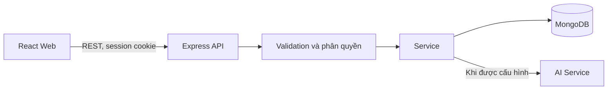

# Kiến trúc Web WQI An Kim Hải

`packages/contracts` chứa Zod schemas và kiểu dùng chung; không chia sẻ model Mongoose ra client. Backend tổ chức theo module Auth, Users, Stations, WaterRecords, Imports, Predictions và Reports. Các luồng Station và WaterRecord tách Controller → Service → Model; module nhỏ giữ route handler mỏng và service cho nghiệp vụ có trạng thái.

Không có dữ liệu mẫu. ImportBatch/ImportedRow giữ nguồn Excel; WaterRecord là dữ liệu đã chuẩn hóa. Chuẩn hóa liên kết một dòng nguồn với một bản ghi, dùng index unique và optimistic version để tránh ghi đè khi cùng sửa.

Khách chỉ đọc trạm active và dữ liệu verified. CSRF token, Origin allow-list, session HttpOnly và kiểm tra quyền tại API bảo vệ thao tác ghi. AI chỉ chạy trên server, không bao giờ trả fallback/mock khi lỗi.
